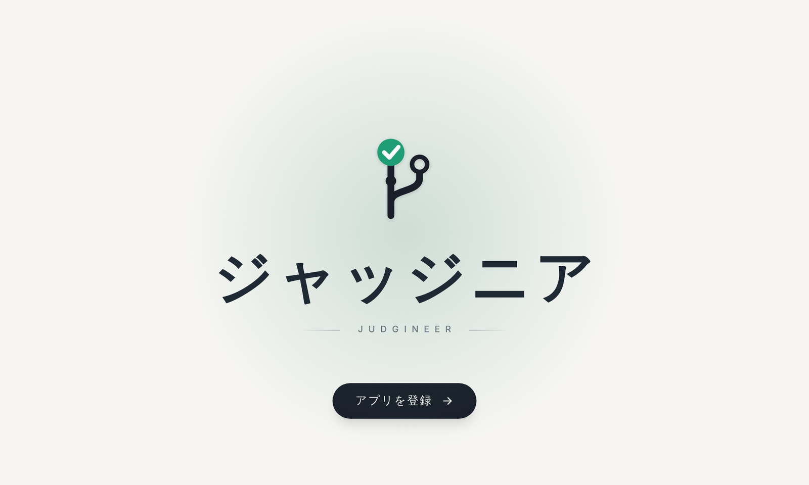
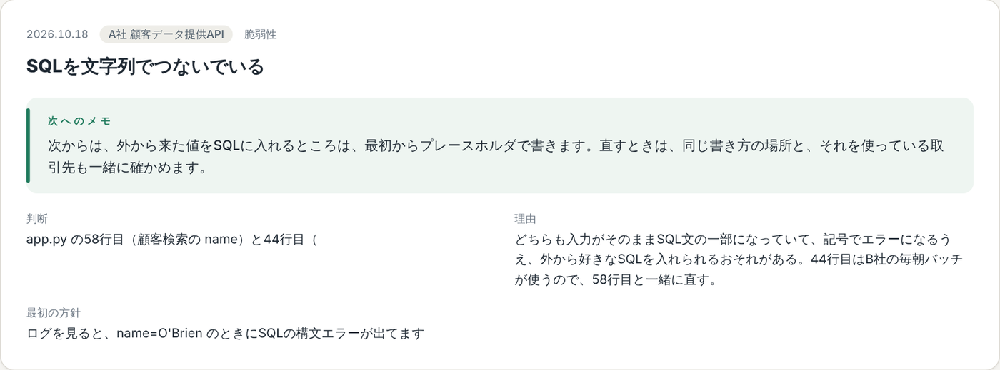
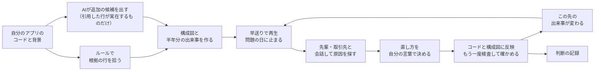
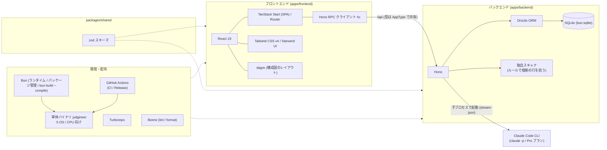

<div align="center">
  
  
  # ジャッジニア(Judgineer)
  AIが当たり前の時代に、根拠を持って判断できるエンジニアになるための経験を積む。
</div>

## Install
```sh
curl -fsSL https://raw.githubusercontent.com/jphacks/tka_2607/main/install.sh | bash
```
> [!IMPORTANT]
> インストール後、ターミナルを再起動するかインストール完了時に表示されるコマンドを入力しないとコマンドを使用できません

### Getting Started
1. 以下のコマンドでプロダクトをアプリに読み込ませることができます
```sh
cd <your-project-folder>
judgineer load
```
> [!NOTE]
> サンプルを読み込む場合
> ```sh
> cd ./tka_2607
> judgineer load ./samples/a_company_api
> ```

2. 実際にプロダクトの背景などを入力して運用シミュレーションを開始

### 停止
```sh
judgineer stop
```

### コマンド一覧を表示
```sh
judgineer help
```

## デモ動画・スライド
<p align="center">
  <a href="https://youtu.be/Xkc3gpJLOJ4"></a>
</p>

- デモ動画：[YouTube](https://youtu.be/Xkc3gpJLOJ4)（登録から、2件の問題を直して3件目が起きるまで）
- 説明スライド：[judgineer-slides.pdf](docs/judgineer-slides.pdf)

## 概要
<p align="center" style="font-weight:bold">
  AI×Tech
</p>
自分のアプリの公開後を先に体験し、起きた問題を根拠をもって自分で判断して直す、運用の練習場所です。

### 背景・課題
<p align="center" style="font-style:italic">
"みなさん、最近AIになんでもかんでも丸投げしていませんか？"
</p>
AIを使うことが悪いわけではありません。うまく活用することで、自分の作業効率を格段に上げることができる、とても便利なツールです。
ですが、今世界は大きな転換点にいます。開発はAIだけで完結できるようになり、AIから出力されたものを信用しきって全部任せるということが多くなってきました。世界の開発者1万5千人以上への調査では、業務で書いたコードのうちAIが丸ごと生成したものが、平均で約47%を占めています[^2]。

趣味の個人開発なら、うまくいかなくても困るのは自分たちだけです。でも、公開して実際に使われているサービスではそうはいきません。問題が起きたときにエンジニアに求められるのは、**根拠をもって説明できる力**だと考えています。

> たとえば、取引先にデータを提供しているサービスで、データが外に漏れるおそれのある欠陥が見つかったとします。すぐに直せるけれど取引先へのデータ提供が止まってしまう案と、取引先に影響はないけれど直すのに時間がかかる案。AIは案を出すことはできても、その取引がどれだけ大事かまでは知りません。どちらを選ぶかは、人が根拠を持って決める必要があります。

また、AIの影響でジュニアとシニアの間の中間層が無くなってしまい、**ジュニアが成長できる機会が少なくなってきている**と感じています。根拠をもって判断できる力が求められているのに、その力を身につける機会が減っている。この二つが、今の社会にある問題だと私たちは考えました。

そこで、本番の前に運用での判断を自分で経験できる場所を作りました。名前のジャッジニアは、判断（ジャッジ）できるエンジニアから付けています。

### 製品概要
ジャッジニアは、自分が作ったアプリを公開したあとに何が起きるかを先に体験し、そこで起きた問題を、根拠を持って自分で判断して直すためのアプリです。
- **誰のためのものか**：AIを使ってアプリを作れるようになった学生や若手エンジニア。そして、そうしたエンジニアを迎え入れる企業。
- **何ができるか**：自分のアプリの、公開後の半年間を早送りで体験できます。起きた問題の原因を自分で探し、直し方を自分の言葉で決めると、その判断に応じてその後の運用が変わります。
- **どこが新しいか**：AIが答えを言わないこと / 題材が自分のアプリのコードであること / 判断に結果がついてくること、の3つです。

### 使い方の流れ
#### 1. アプリを登録する

自分が作ったアプリのコードと、そのアプリの背景を登録します。背景とは、取引先との関係、契約の内容、扱うデータの種類、チームの人数などのことです。

https://github.com/user-attachments/assets/e158500b-9917-4251-a311-9465f3c88b41

#### 2. 半年間早送りする

アプリを公開してからの半年間を、動画のシークバーのように早送りしながら再生します。もし影響が出た場合は構成図に示されます。

https://github.com/user-attachments/assets/b11b510a-799f-4e04-b1d0-4c6c091f6003

#### 3. 問題が起きて止まる

問題が起きて再生が止まります。たとえば、取引先から「顧客データが外から見えている」と連絡が来たり、エラーの記録（ログ）が急に増えたりします。原因は登録した自分のアプリのコードの中にあり、問題に関係する行には印が付きます。

https://github.com/user-attachments/assets/e810c1ff-4c6f-4d5a-bd07-461066dd2e0e

#### 4. 会話しながら原因を探す

AIが演じる先輩エンジニアや取引先の担当者と会話しながら、ログ、コード、システムの構成図を見て原因を探します。先輩は答えを言わず、問いかけてきます。途中で取引先から「いつ直りますか」と催促が入ることもあります。

https://github.com/user-attachments/assets/5beceed0-49d1-4e7e-b50b-8184c115c29d

この例では、こちらが直し方を言っても先輩は答え合わせをせず、構成図でこの処理を毎朝呼んでいるのは誰か、と問い返してきました。直したときに誰に影響するかまで考えさせるためです。

#### 5. 直し方を自分で決める

原因がわかったら、どう直すかを自分の言葉で決めます。決めた内容は実際にコードに反映され、もう一度検査して、元の問題が消えたかどうかも確かめます。

https://github.com/user-attachments/assets/96c95949-cf18-4682-b285-a7b0e00df032

#### 6. その後の運用が変わる

直し方によって、この先の半年間に起きることが変わります。その問題が起きなくなることもあれば、直し方が原因で別の日に新しい問題が起きることもあります。直さずに後回しにすることもできますが、重要な問題を後回しにすると、後でもっと大きな問題になって返ってくることもあります。

https://github.com/user-attachments/assets/c284e190-31fc-4009-a111-a0f2cb44c8c6

この例では、1件目の直し方がきっかけで、別の問題が新しく起きています。

#### 7. 判断を記録に残す

最後に原因の答え合わせをして振り返ると、判断と理由、次へのメモが記録に残ります。次に別のアプリを登録したときには、似た場面で前回どう判断したかが表示されます。

<p align="center"></p>

### アプリのフロー図


### 特長
#### 1. AIは答えを言わない
AIに聞けば答えが返ってくる、という使い方をあえてやめました。先輩役のAIは答えを言わずに問いかけ、ログやコードのどこを見ればよいかに気づかせます。原因の名前も言いません。いくつかの選択肢から正解を選ぶ形にもしていません。選ぶだけでは経験になりにくいためです。どうしても詰まったときは、ヒントだけをもらえます。

ある研究[^1]でも、AIに仕組みを質問しながら自分で書いた人は理解が残り、全部を任せた人は残りませんでした。ジャッジニアの先輩は、前者の使い方になるように話しかけてきます。

#### 2. 自分のアプリが題材になる
用意された練習問題ではなく、自分が作ったアプリのコードと背景をもとに、公開後に起きそうな問題を作ります。どの問題にも、それがコードのどのファイルの何行目から起きているかが必ず紐づいているので、原因を根拠から追うことができます。

#### 3. 判断に結果がついてくる
選んだ直し方によって、その後に起きる問題が、起きなくなる、小さくなる、大きくなる、新しく起きる、のいずれかに変わります。取引先や上司は、締め切りや契約、人手が足りないといった事情を持ち込んできます。現場と同じように、判断には結果と責任がついてきます。

#### 4. 失敗も経験として残る
本番のサービスではないので、間違った判断をしても誰にも迷惑はかかりません。うまくいかなかった判断も、なぜそうなったかと一緒に記録に残り、次のアプリを作るときに見返せます。失敗した経験が、そのまま次の判断の材料になります。

### ほかの方法との違い
| 方法 | 扱うもの | 答えを出すのは | 判断したあと |
|---|---|---|---|
| ChatGPTなどの汎用AI | 質問したこと | AI | 何も起きない |
| コードの検査ツール・脆弱性診断 | 公開前のコード | ツール | 何も起きない |
| 研修や教材 | 用意された練習問題 | 教材の正解 | 何も起きない |
| **ジャッジニア** | **自分のアプリの、公開後に起きる問題** | **自分** | **その後の運用が変わる** |

汎用のAIに「答えを言わずに問いかけて」と頼むこともできますが、問題は自分で用意する必要があり、判断したあとに何が起きるかも返ってきません。ジャッジニアは、自分のコードの実際の行から問題を作り、判断の結果をその後の半年間に反映させます。

### 解決できること
#### エンジニアにとって
- AIに任せきりにせず、根拠を持って判断する経験を、本番の前に何度でも積めます。失敗しても、それが次に活きる経験になります。
- AIのスピードと自分の根拠、その両方を持ったエンジニアを目指せます。AIを使わないのではなく、使いこなしたうえで最後は自分で判断できる状態です。
- 判断の経験を重ねることで、運用を任せられる中堅のエンジニアへと成長していけます。
- 問題の原因を追ううちに、セキュリティやインフラ、扱うデータの業界など、向き合った分野が自分の強みになっていきます。

#### 企業にとって
- 新しく入ったエンジニアが、実際の障害に向き合う前に、運用で起きうる問題への判断を経験しておけます。
- ベテランが付きっきりで教えなくても経験を積めるので、育成の負担が下がります。
- 判断できる人が増えることで、障害対応の判断が一部の人に集中している状態を減らせます。
- 誰がどんな問題にどう判断したかが記録に残るので、育成の状況を確かめやすくなります。

#### 価値があるのは、直したコードより判断した経験
セキュリティの対策は、新しい攻撃が出るたびに追いかけ続けることになり、終わりがありません。なので、ジャッジニアは穴のないアプリを作るための道具ではありません。
攻撃の手口が変わっても、ログやコードから原因を確かめ、取引先や契約の事情まで踏まえて直し方を決める、という判断の進め方は変わりません。ジャッジニアで残るのは、直したコードそのものよりも、根拠を持って判断した経験です。

### 力を入れたこと
#### 1. AIには答えを言わせない
AIが出すのは事実と問いかけだけで、どう直すかは必ず人が決めます。おすすめの案も出しません。先輩の話し方は、良い問いかけと、答えを言ってしまう悪い問いかけを並べて決めています。（[prompts/chat.ts](./apps/backend/src/prompts/chat.ts)）

#### 2. 実際のコードに原因がある問題だけを起こす
起きる問題は、まずプログラムのルールでコードの該当行を拾い、その行を根拠に作っています。ルールで拾えない欠陥はAIに候補を出させますが、AIが引用した行が実際のコードにあるものだけを使います。ありえない問題に振り回されることはありません。（[scanner.ts](./apps/backend/src/scanner.ts)、[extra.ts](./apps/backend/src/extra.ts)）

#### 3. 直ったかどうかをコードで確かめる
修正を反映したあと、コードをもう一度検査して、元の問題が消えたか、残っているか、新しく生まれたかを判定しています。直したつもりで直っていない場面も、そのまま結果に出ます。（[verify.ts](./apps/backend/src/verify.ts)）

#### 4. 判断で何が変わったかを見せる
修正前後のコードの違い、システム構成の変化、この先の半年間への影響まで表示します。修正は登録したアプリのコピーにだけ入れていて、元のファイルは変えません。（[fix.ts](./apps/backend/src/fix.ts)、[FixView.tsx](./apps/frontend/src/components/FixView.tsx)）

#### 5. すぐに試せる形で配る
コマンド1行でインストールでき、`judgineer load` で今いるフォルダのアプリをすぐ読み込めるようにしました。OSごとの単体バイナリを作って配っています。（[install.sh](./install.sh)、[build-binary.ts](./scripts/build-binary.ts)）

## 今後の展望
### 判断の力を測る適性検査
- **知識ではなく判断を測る**: コードを書く速さや知識の量を測る従来のテストは、AIを使えば点が取れてしまう。根拠を持って判断できるかを測る検査にする
- **過程を見る**: 正解したかではなく、ログやコードのどこを根拠にしたか、取引先や契約の事情をどう踏まえたかを見る
- **採用や配属に使える**: 企業が、知識の量だけではわからない判断の力を見る材料として使えるようにする

### 題材を増やす
- **業種ごとの題材**: 個人情報、医療、決済など、扱うデータごとに起きやすい問題を用意する
- **自社のコードがなくても練習できる**: 手元に題材がない人や、自社のコードを使えない企業でも試せるようにする

## 技術スタック
今回のプロダクトは、サーバーなどにデプロイしてしまうと、プロダクトをAIに読ませる方法が難しくなったり、セキュリティの問題などが出やすくなるため、できるだけアプリ自体はできるだけ薄く作成することを意識しました。
また型安全などの非機能要件も意識して技術を選定しました。
### API・データ
- Claude Code（`claude` コマンド）
  構成図・利用シナリオ・出来事の台本・修正案の生成に使用しています。
- SQLite: 解析結果や会話の履歴を保存する。今回の技術スタックはサーバー上に置くのではなく、完全にローカルで動かすため、できるだけ軽量なものを選択しました。

### バックエンド
- TypeScript
  フロントとバックで同じ言語を使い、型を共有して書き間違いを早い段階で見つけられるようにしました。
- Bun
  ランタイム、パッケージ管理、テスト、単体バイナリ化を1つでまかなえ、ローカルで動かす配布物を作りやすいためです。
- Turborepo
  フロント・バック・共有スキーマを1つのリポジトリにまとめ、ビルドや型チェックをまとめて回すために使っています。
- Hono
  軽量で、型付きのAPIクライアント（RPC）によりフロントへ型をそのまま渡せる点から選びました。
- Biome
  lint と format を1つのツールで済ませ、設定を少なくするためです。また高速で実行されることからも採用しました。
- zod
  API の入出力の形を1か所に定義し、フロントとバックの両方で検証と型に使えるためです。

### フロントエンド
- TanStack Start
  型安全なルーティングを中心に据えている点から
- React
  動的に動くページが多いためReactを選択。またコンポーネントを用いて開発効率を高められるよう意識しました。
- Tailwind
  Starwind UIで使用するということ、簡単にCSSを記述できるため採用しました
- Starwind UI
  できるだけ軽量で高速、なおかつモダンなUIを使用したかったため採用しました。

### 技術スタック図


[^1]: Anthropicが行ったランダム化比較試験では、AIを使って新しいライブラリを学んだグループは、手で書いたグループより理解度テストの点が17ポイント低くなりました。特に差が大きかったのはデバッグの問題です。同じAIを使っていても、コードを書くことを全部AIに任せた人は40%未満、仕組みについての質問だけをAIにして自分で書いた人は65%以上と、使い方で大きく分かれました。
Anthropic「How AI assistance impacts the formation of coding skills」（2026年1月、エンジニア52人のランダム化比較試験）。[記事](https://www.anthropic.com/research/AI-assistance-coding-skills)

[^2]: JetBrains「Developer Ecosystem Survey 2026」の分析（2026年8月公表、世界の開発者1万5千人以上）。AIの助けなしでコードを書いたことがない開発者も21%いました。[＠ITの記事](https://atmarkit.itmedia.co.jp/ait/articles/2609/28/news045.html)
