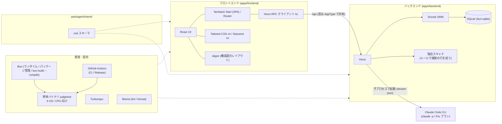

# ジャッジニア（Judgineer）

[](https://www.youtube.com/watch?v=piaNsc6ilBI)

AI が当たり前の時代に、根拠を持って判断できるエンジニアになるための経験を積むプロダクト。

## 製品概要
### 背景(製品開発のきっかけ、課題等）
#### AI に任せきりになっていないか
生成 AI のおかげで、コードを書くことも、エラーの原因を調べることも、AI に頼めばすぐに答えが返ってくるようになりました。ITエンジニア 1,265 人への調査では、生成 AI を使っている人の 44.1% が、AI によって「エラー原因の調査」の時間が減ったと答えています（スーパーソフトウエア, 2026 年 8 月）。

学生のうちは、AI に任せきりでも作品は完成します。しかし企業に入ってエンジニアとして働くようになると、話が変わります。運用しているサービス（公開して実際に使われているサービス）で問題が起きたとき、どう直すかを決めるのは自分で、その結果に責任を持つのも自分です。そのとき、AI がそう言ったから、という理由は通用しません。

同じ調査でも、91.5% のエンジニアが「最終的に人が責任を持つべき仕事がある」と答えています。中身として多かったのは、AI が作ったものの正しさの確認（39.9%）や、品質や安全性の判断（30.7%）でした。

#### 根拠を持って判断する力は、経験でしか身につかない
問題が起きたときにどう直すかは、ひとつの正解があるわけではありません。たとえば、次のような状況を考えます。

> A 社は自社の顧客データを持っていて、そのデータを取引先の B 社に提供しています。B 社はそのデータを使って商売をしています。ある日、A 社のシステムに、顧客データが外部に漏れるおそれのある欠陥（脆弱性）が見つかりました。

直し方の案として、次の 2 つがあるとします。

* 案 1：欠陥は直せて作業も少ないが、B 社へのデータ提供が止まってしまう
* 案 2：欠陥は直せて B 社にも影響しないが、作業が多く時間がかかる

AI はこうした修正案を出すことはできますが、A 社にとって B 社との取引がどれだけ大事かまでは知りません。どちらを選ぶかは、ログやコードから原因を確かめ、取引や契約といった事情も踏まえて、人が根拠を持って決める必要があります。

こうした判断の力は、本を読んだり AI に聞いたりするだけでは身につかず、実際に問題に向き合った経験がものを言います。

#### 企業にとっての課題：AI 世代のエンジニアを迎える準備ができていない
これから企業には、学生のころから AI を当たり前に使ってきたエンジニアが入ってきます。コードを書くのは速くても、運用で問題が起きたときに根拠を持って判断した経験は、ほとんどない状態で現場に立つことになります。

一方で、企業の側にも、判断の経験を積ませる余裕がありません。運用での判断は、これまでベテランが実際の障害対応の中で少しずつ教えてきました。しかし今は、その判断ができる人自体が限られています。大企業で障害対応をしているエンジニア 316 人への調査では、39.9% の職場で障害対応の判断や知識が 3 人以下に集中していて、68.0% が中心の担当者がいないと同じ水準の対応は難しいと答えています（PagerDuty, 2026 年 8 月）。

このままでは、新しく入ってきたエンジニアは判断の経験を積めないまま、限られたベテランに頼り続けることになります。ベテランの負担は増え続け、その人がいなくなったときに対応できる人が残りません。

#### 私たちの考え
私たちは、これからのエンジニアに本当に求められるのは、根拠を持って意思決定できる力だと考えています。そこで、本番の前に、運用での判断を自分で経験できる場所を作りました。

### 製品説明（具体的な製品の説明）
ジャッジニアは、自分が作ったアプリを公開したあとに何が起きるかを先に体験し、そこで起きた問題を、根拠を持って自分で判断して直すためのアプリです。

```
アプリを作る → 完成 → ジャッジニアで公開後の運用を体験 → 判断の経験が残る → 次のアプリづくりに活かす
```

1. 自分が作ったアプリのコードと、そのアプリの背景を登録します。背景とは、取引先との関係、契約の内容、扱うデータの種類、チームの人数などのことです。
2. アプリを公開してからの半年間を、動画のシークバーのように早送りしながら再生します。どんな問題が起きるかは、その日になるまでわかりません。
3. ある日、問題が起きて再生が止まります。たとえば、取引先から「顧客データが外から見えている」と連絡が来たり、エラーの記録（ログ）が急に増えたりします。原因は、登録した自分のアプリのコードの中にあります。
4. AI が演じる先輩エンジニアや取引先の担当者と会話しながら、ログ、コード、システムの構成図を見て原因を探します。先輩は答えを言わず、「ログのこの行、何て書いてある？」のように問いかけてきます。途中で取引先から「いつ直りますか」と催促が入ることもあります。
5. 原因がわかったら、どう直すかを自分の言葉で決めます。決めた内容は実際にコードに反映され、修正前後のコードの違いと、システムの構成がどう変わったかが表示されます。
6. 直し方によって、この先の半年間に起きることが変わります。その問題が起きなくなることもあれば、直し方が原因で別の日に新しい問題が起きることもあります。直さずに後回しにすることもできますが、重要な問題を後回しにすると、後でもっと大きな問題になって返ってくることもあります。
7. 最後に原因の答え合わせをして、自分の判断を記録に残します。次に別のアプリを登録したときには、似た場面で前回どう判断したかが表示されます。

### 特長
#### 1. AI は答えを言わない
AI に聞けば答えが返ってくる、という使い方をあえてやめました。先輩役の AI は答えを言わずに問いかけ、ログやコードのどこを見ればよいかに気づかせます。いくつかの選択肢から正解を選ぶ形にもしていません。選ぶだけでは経験になりにくいためです。どうしても詰まったときは、ヒントだけをもらえます。

#### 2. 自分のアプリが題材になる
用意された練習問題ではなく、自分が作ったアプリのコードと背景をもとに、公開後に起きそうな問題を作ります。どの問題にも、それがコードのどのファイルの何行目から起きているかが必ず紐づいているので、原因を根拠から追うことができます。

#### 3. 判断に結果がついてくる
選んだ直し方によって、その後に起きる問題が、起きなくなる、小さくなる、大きくなる、新しく起きる、のいずれかに変わります。取引先や上司は、締め切りや契約、人手が足りないといった事情を持ち込んできます。現場と同じように、判断には結果と責任がついてきます。

#### 4. 失敗も経験として残る
本番のサービスではないので、間違った判断をしても誰にも迷惑はかかりません。うまくいかなかった判断も、なぜそうなったかと一緒に記録に残り、次のアプリを作るときに見返せます。失敗した経験が、そのまま次の判断の材料になります。

### 解決できること
* 若手が、AI に任せきりにせず、根拠を持って判断する経験を、本番の前に何度でも積めます。失敗しても、それが次に活きる経験になります。
* AI が当たり前の世代のエンジニアが判断の経験を積むことで、AI のスピードと自分の根拠の両方を持ったエンジニアになれます。AI を使わないのではなく、AI を使いこなしたうえで、最後は自分で判断できる状態を目指します。
* 判断の経験を重ねることで、運用の問題を任せられる中堅のエンジニアへと成長していけます。
* 問題の原因を追ううちに、セキュリティ、インフラ、扱うデータの業界など、自分が向き合った分野が自分の強みになっていきます。

企業にとっては、次のことが解決できます。

* 新しく入ってきたエンジニアが、実際の障害に向き合う前に、自社の運用で起きうる問題への判断を経験しておけます。
* ベテランが付きっきりで教えなくても判断の経験を積めるので、育成の負担が下がります。空いたベテランの時間は開発や事業に、浮いたコストは若手の採用に回せます。
* 判断できる人が増えることで、障害対応の判断が一部の人に集中している状態を減らし、その人がいなくても対応できる体制に近づけます。
* 誰がどんな問題にどう判断したかが記録に残るので、育成の状況を確認しやすくなります。

コードの書き方をチェックするツールや、脆弱性を見つける診断ツールは、主にアプリを公開する前のコードを対象にしています。ジャッジニアが扱うのは、公開後に起きる問題と、それにどう対応するかという人の判断です。

攻撃の手口は進化し続けるので、対策しても終わりがないのではという意見もあると思います。ただ、ジャッジニアの目的は完璧なアプリを作ることではありません。目指しているのは、問題に向き合って根拠を持って判断し、それを次に活かせるようになることです。

### 今後の展望
* 企業向けに、若手の育成を継続的に支えるサービスとして提供したいと考えています。コードが変わるたびに新しいシナリオを作る、新人が入るたびに使える、マネージャーが若手一人ひとりの成長を確認できる、といった形を考えています。
* 個人情報や医療情報など、業種や扱うデータごとの題材を増やし、自社のコードを使えない場合でも練習できるようにします。

### 力を入れたこと（こだわり等）
* AI には正解を選ばせていません。AI が出すのは事実と問いかけだけで、どう直すかは必ず人が決めます。おすすめの案も出しません。
* 起きる問題は、コードをプログラムで自動チェックして見つかった箇所をもとに作っています。実際のコードに原因がある問題だけが起きるので、ありえない問題に振り回されることがありません。
* 選択肢を選ぶ形ではなく、会話で進む形にしました。先輩は答えを言わず、関係者は判断を急かしてくるので、実際の現場に近い状況で判断できます。
* 修正前後のコードの違い、システム構成の変化、この先の半年間への影響まで見せて、自分の判断で何が変わったかがわかるようにしました。
* 修正は登録したアプリのコピーにだけ入れていて、元のファイルは変えません。

## 開発技術
### 活用した技術
#### API・データ
* Claude Code（`claude` コマンド）: 構成図・利用シナリオ・出来事の台本・修正案の生成に使う。API キーは使わず、手元のログイン（Pro プラン）で動かす
* SQLite: 解析結果や会話の履歴をローカルに保存する

#### フレームワーク・ライブラリ・モジュール
* フロントエンド: TanStack Start（SPA モード）/ React 19 / Tailwind CSS v4 / Starwind UI
* バックエンド: Hono / Drizzle ORM（SQLite）
* 共通: zod（フロント・バックで共有するスキーマ）/ Bun / Turborepo / Biome

#### 技術スタック図


### 独自技術
#### ハッカソンで開発した独自機能・技術
* 独自で開発したものの内容をこちらに記載してください
* 特に力を入れた部分をファイルリンク、またはcommit_idを記載してください。

## Install
```sh
curl -fsSL https://raw.githubusercontent.com/jphacks/tka_2607/main/install.sh | bash
```
Linux / macOS / Windows（Git Bash から実行）に対応。`~/.judgineer` に置かれ、`judgineer` コマンドが使えるようになる。AI の機能には Claude Code（`claude`）が必要。

### コマンド
```sh
bun install          # 依存関係のインストール
bun run dev          # frontend と backend を同時に起動
bun run build        # ビルド
bun run typecheck    # 型チェック
bun run test         # テスト
bun run check        # lint と format の検査（Biome）
bun run format       # lint と format の自動修正（Biome）
```

## 開発者向けセットアップ
### 構成
```
apps/frontend    TanStack Start (SPA) + React + Starwind UI   http://localhost:3000
apps/backend     Hono + Drizzle (bun:sqlite)                  http://127.0.0.1:3001
packages/shared  zod スキーマ（フロント・バック共有）
```

### 必要なもの
* [Bun](https://bun.com/) 1.4 以上（Node.js / pnpm は不要）

* 開発時、フロントの `/api` はバックエンドへプロキシされる。
* バックエンドの環境変数は `apps/backend/.env.example` を参照（`PORT`、`DATABASE_URL`）。
* 開発時は、起動時に環境変数 `TARGET_DIR`（既定は `samples/a_company_api`）を検査対象の一覧へ足す。デモ用の題材が `samples/` にあるので、そのまま `bun run dev` すると試せる。
* 修正は検査対象のコピー（`data/projects/<id>/current`）にだけ入り、元のファイルは変わらない。
* VS Code では拡張機能「Biome」（`biomejs.biome`）を入れると、保存時に lint と format が自動で走る。

### judgineer コマンド（単体バイナリ）
`bun run build && bun run build:binary` で `dist-bin/` に OS ごとの単体バイナリを作れる。

```sh
judgineer help        # コマンドの一覧
judgineer load        # 今いるフォルダをプロジェクトの一覧に加えて、ブラウザで開く（ディレクトリも指定できる）
judgineer start       # サーバーだけを裏で起動する
judgineer stop        # サーバーを止める
judgineer update      # 最新のリリースを確認し、新しい版があれば置き換える（--check は確認だけ）
judgineer uninstall   # 削除する（--purge で解析データも消す）
```

リリースは `.github/workflows/release.yml` が、公開時に 5 つの OS / CPU 向けの単体バイナリと `SHA256SUMS` を添付する。ビルド中でバイナリが無いときは、`install.sh` が最新から 5 件前までさかのぼって探す。

詳しい開発ルールは [AGENTS.md](./AGENTS.md) を参照。
