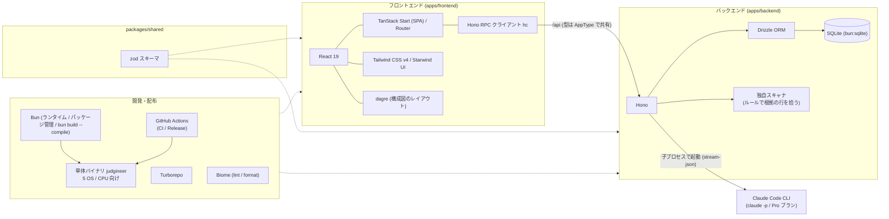

# ジャッジニア（Judgineer）

[](https://www.youtube.com/watch?v=piaNsc6ilBI)

AI が当たり前の時代に、根拠を持って判断できるエンジニアになるための経験を積むプロダクト。

## すぐに試す
```sh
curl -fsSL https://raw.githubusercontent.com/jphacks/tka_2607/main/install.sh | bash
judgineer load
```
1 行目でインストールし、2 行目で今いるフォルダのアプリを登録してブラウザで開きます。Linux / macOS / Windows（Git Bash）に対応しています。AI の機能には Claude Code（`claude` コマンド）へのログインが必要です。

手元に試せるアプリがなくても、このリポジトリの [samples/](./samples) にデモ用の題材があります。題材のフォルダで `judgineer load` を実行すると体験できます。

- デモ動画：（準備中）
- 発表スライド：（準備中）

<!-- スクリーンショット：インシデントで再生が止まった画面 -->

## 目次
- [製品概要](#製品概要)
  - [背景](#背景製品開発のきっかけ課題等)
  - [製品説明](#製品説明具体的な製品の説明)
  - [特長](#特長)
  - [ほかの方法との違い](#ほかの方法との違い)
  - [解決できること](#解決できること)
  - [今後の展望](#今後の展望)
  - [力を入れたこと](#力を入れたことこだわり等)
- [開発技術](#開発技術)

## 製品概要
### 背景(製品開発のきっかけ、課題等）
みなさん、最近 AI に丸投げしていませんか？

#### AI に任せきりでも、作品は完成してしまう
生成 AI のおかげで、コードを書くことも、エラーの原因を調べることも、AI に頼めばすぐに答えが返ってくるようになりました。IT エンジニア 1,265 人への調査では、生成 AI を使っている人の 44.1% が、AI によってエラー原因の調査の時間が減ったと答えています（スーパーソフトウエア, 2026 年 8 月）。

学生のうちは、AI に任せきりでも作品は完成します。しかし企業に入ってエンジニアとして働くようになると、話が変わります。運用しているサービス（公開して実際に使われているサービス）で問題が起きたとき、どう直すかを決めるのは自分で、その結果に責任を持つのも自分です。そのとき、AI がそう言ったから、という理由は通用しません。

同じ調査でも、91.5% のエンジニアが、最終的に人が責任を持つべき仕事があると答えています。中身として多かったのは、AI が作ったものの正しさの確認（39.9%）や、品質や安全性の判断（30.7%）でした。

#### 根拠を持って判断する力は、経験でしか身につかない
問題が起きたときにどう直すかは、ひとつの正解があるわけではありません。たとえば、次のような状況を考えます。

> A 社は自社の顧客データを持っていて、そのデータを取引先の B 社に提供しています。B 社はそのデータを使って商売をしています。ある日、A 社のシステムに、顧客データが外部に漏れるおそれのある欠陥（脆弱性）が見つかりました。

直し方の案として、次の 2 つがあるとします。

| | 欠陥 | B 社への影響 | 作業の量 |
|---|---|---|---|
| 案 1 | 直せる | データ提供が止まる | 少ない |
| 案 2 | 直せる | 影響しない | 多く、時間がかかる |

AI はこうした修正案を出すことはできますが、A 社にとって B 社との取引がどれだけ大事かまでは知りません。どちらを選ぶかは、ログやコードから原因を確かめ、取引や契約といった事情も踏まえて、人が根拠を持って決める必要があります。

こうした判断の力は、本を読んだり AI に聞いたりするだけでは身につかず、実際に問題に向き合った経験がものを言います。

#### 企業の側にも、判断の経験を積ませる余裕がない
これから企業には、学生のころから AI を当たり前に使ってきたエンジニアが入ってきます。コードを書くのは速くても、運用で問題が起きたときに根拠を持って判断した経験は、ほとんどない状態で現場に立つことになります。

運用での判断は、これまでベテランが実際の障害対応の中で少しずつ教えてきました。しかし今は、その判断ができる人自体が限られています。大企業で障害対応をしているエンジニア 316 人への調査では、39.9% の職場で障害対応の判断や知識が 3 人以下に集中していて、68.0% が中心の担当者がいないと同じ水準の対応は難しいと答えています（PagerDuty, 2026 年 8 月）。

このままでは、新しく入ってきたエンジニアは判断の経験を積めないまま、限られたベテランに頼り続けることになります。

#### 課題をまとめると
| 誰の課題か | 課題 |
|---|---|
| これからのエンジニア | AI で作ることはできても、運用で問題が起きたときに根拠を持って判断した経験がない |
| 企業 | 判断できる人が限られていて、新しく入った人に経験を積ませる余裕がない |

私たちは、これからのエンジニアに本当に求められるのは、根拠を持って意思決定できる力だと考えています。そこで、本番の前に、運用での判断を自分で経験できる場所を作りました。

### 製品説明（具体的な製品の説明）
ジャッジニアは、自分が作ったアプリを公開したあとに何が起きるかを先に体験し、そこで起きた問題を、根拠を持って自分で判断して直すためのアプリです。

- **誰のためのものか**：AI を使ってアプリを作れるようになった学生や若手エンジニア。そして、そうしたエンジニアを迎え入れる企業。
- **何ができるか**：自分のアプリの、公開後の半年間を早送りで体験できます。起きた問題の原因を自分で探し、直し方を自分の言葉で決めると、その判断に応じてその後の運用が変わります。
- **どこが新しいか**：AI が答えを言わないこと、題材が自分のアプリのコードであること、判断に結果がついてくること、の 3 つです。

```
アプリを作る → 完成 → ジャッジニアで公開後の運用を体験 → 判断の経験が残る → 次のアプリづくりに活かす
```

#### 使い方の流れ
1. **アプリを登録する**：自分が作ったアプリのコードと、そのアプリの背景を登録します。背景とは、取引先との関係、契約の内容、扱うデータの種類、チームの人数などのことです。
2. **半年間を早送りする**：アプリを公開してからの半年間を、動画のシークバーのように早送りしながら再生します。どんな問題が起きるかは、その日になるまでわかりません。
3. **問題が起きて止まる**：ある日、問題が起きて再生が止まります。たとえば、取引先から「顧客データが外から見えている」と連絡が来たり、エラーの記録（ログ）が急に増えたりします。原因は、登録した自分のアプリのコードの中にあります。
4. **会話しながら原因を探す**：AI が演じる先輩エンジニアや取引先の担当者と会話しながら、ログ、コード、システムの構成図を見て原因を探します。先輩は答えを言わず、「ログのこの行、何て書いてある？」のように問いかけてきます。途中で取引先から「いつ直りますか」と催促が入ることもあります。
5. **直し方を自分で決める**：原因がわかったら、どう直すかを自分の言葉で決めます。決めた内容は実際にコードに反映され、修正前後のコードの違いと、システムの構成がどう変わったかが表示されます。
6. **その後の運用が変わる**：直し方によって、この先の半年間に起きることが変わります。その問題が起きなくなることもあれば、直し方が原因で別の日に新しい問題が起きることもあります。直さずに後回しにすることもできますが、重要な問題を後回しにすると、後でもっと大きな問題になって返ってくることもあります。
7. **判断を記録に残す**：最後に原因の答え合わせをして、自分の判断を記録に残します。次に別のアプリを登録したときには、似た場面で前回どう判断したかが表示されます。

<!-- スクリーンショット：先輩との会話画面 -->

### 特長
#### 1. AI は答えを言わない
AI に聞けば答えが返ってくる、という使い方をあえてやめました。先輩役の AI は答えを言わずに問いかけ、ログやコードのどこを見ればよいかに気づかせます。原因の名前（たとえば SQL インジェクション）も先には言いません。いくつかの選択肢から正解を選ぶ形にもしていません。選ぶだけでは経験になりにくいためです。どうしても詰まったときは、ヒントだけをもらえます。

<!-- スクリーンショット：先輩が問いかけている会話 -->

#### 2. 自分のアプリが題材になる
用意された練習問題ではなく、自分が作ったアプリのコードと背景をもとに、公開後に起きそうな問題を作ります。どの問題にも、それがコードのどのファイルの何行目から起きているかが必ず紐づいているので、原因を根拠から追うことができます。

<!-- スクリーンショット：シークバーと、問題が起きた日 -->

#### 3. 判断に結果がついてくる
選んだ直し方によって、その後に起きる問題が、起きなくなる、小さくなる、大きくなる、新しく起きる、のいずれかに変わります。取引先や上司は、締め切りや契約、人手が足りないといった事情を持ち込んできます。現場と同じように、判断には結果と責任がついてきます。

<!-- スクリーンショット：修正前後のコードの差分と、構成図の変化 -->

#### 4. 失敗も経験として残る
本番のサービスではないので、間違った判断をしても誰にも迷惑はかかりません。うまくいかなかった判断も、なぜそうなったかと一緒に記録に残り、次のアプリを作るときに見返せます。失敗した経験が、そのまま次の判断の材料になります。

<!-- スクリーンショット：判断の記録の画面 -->

### ほかの方法との違い
| | 扱うもの | 答えは誰が出すか | 判断の結果 |
|---|---|---|---|
| ChatGPT などの汎用 AI | 質問したこと | AI | 返ってこない |
| コードの検査ツール・脆弱性診断 | 公開前のコード | ツール | 返ってこない |
| 研修や教材 | 用意された練習問題 | 教材に正解がある | 返ってこない |
| **ジャッジニア** | **自分のアプリの、公開後に起きる問題** | **自分** | **その後の運用が変わる** |

汎用の AI に、答えを言わずに問いかけて、と頼むことはできます。ただ、その場合は問題そのものを自分で用意する必要があり、判断したあとに何が起きるかも返ってきません。ジャッジニアは、自分のコードの実際の行から問題を作り、判断の結果をその後の半年間に反映させ、判断の記録を残します。

### 解決できること
* AI に任せきりにせず、根拠を持って判断する経験を、本番の前に何度でも積めます。失敗しても、それが次に活きる経験になります。
* AI が当たり前の世代のエンジニアが判断の経験を積むことで、AI のスピードと自分の根拠の両方を持ったエンジニアになれます。AI を使わないのではなく、AI を使いこなしたうえで、最後は自分で判断できる状態を目指します。
* 判断の経験を重ねることで、運用の問題を任せられる中堅のエンジニアへと成長していけます。
* 問題の原因を追ううちに、セキュリティ、インフラ、扱うデータの業界など、自分が向き合った分野が自分の強みになっていきます。

企業にとっては、次のことが解決できます。

* 新しく入ってきたエンジニアが、実際の障害に向き合う前に、自社の運用で起きうる問題への判断を経験しておけます。
* ベテランが付きっきりで教えなくても判断の経験を積めるので、育成の負担が下がります。空いたベテランの時間は開発や事業に、浮いたコストは若手の採用に回せます。
* 判断できる人が増えることで、障害対応の判断が一部の人に集中している状態を減らし、その人がいなくても対応できる体制に近づけます。
* 誰がどんな問題にどう判断したかが記録に残るので、育成の状況を確認しやすくなります。

#### 価値があるのは、直したコードより判断した経験
セキュリティの対策は、新しい攻撃が出るたびに追いかけ続けることになり、終わりがありません。そのため、私たちはジャッジニアを、穴のないアプリを作るための道具とは考えていません。攻撃の手口が変わっても、ログやコードから原因を確かめ、取引先や契約の事情まで踏まえて直し方を決める、という判断の進め方は変わりません。ジャッジニアで残るのは、直したコードそのものよりも、根拠を持って判断した経験です。その経験は、次にどんな問題が来ても使えます。

### 今後の展望
* 企業向けに、若手の育成を継続的に支えるサービスとして提供したいと考えています。コードが変わるたびに新しいシナリオを作る、新人が入るたびに使える、マネージャーが若手一人ひとりの成長を確認できる、といった形を考えています。
* 個人情報や医療情報など、業種や扱うデータごとの題材を増やし、自社のコードを使えない場合でも練習できるようにします。

### 力を入れたこと（こだわり等）
* **AI には答えを言わせない**：AI が出すのは事実と問いかけだけで、どう直すかは必ず人が決めます。おすすめの案も出しません。先輩の話し方は、良い問いかけと悪い問いかけ（答えを言ってしまう例）を並べて決めています（[prompts/chat.ts](./apps/backend/src/prompts/chat.ts)）。
* **実際のコードに原因がある問題だけを起こす**：起きる問題は、まずプログラムのルールでコードの該当行を拾い、その行を根拠に作っています（[scanner.ts](./apps/backend/src/scanner.ts)）。ルールで拾えない欠陥は AI に候補を出させますが、AI が引用した行が実際のコードにあるものだけを採用します（[extra.ts](./apps/backend/src/extra.ts)）。ありえない問題に振り回されることがありません。
* **直ったかどうかをコードで確かめる**：修正を反映したあと、コードをもう一度検査して、元の問題が消えたか、残っているか、新しく生まれたかを判定しています（[verify.ts](./apps/backend/src/verify.ts)）。直したつもりで直っていない、という場面もそのまま結果に出ます。
* **選択肢ではなく会話で進める**：先輩は答えを言わず、関係者は判断を急かしてくるので、実際の現場に近い状況で判断できます。
* **判断で何が変わったかを見せる**：修正前後のコードの違い、システム構成の変化、この先の半年間への影響まで表示します（[fix.ts](./apps/backend/src/fix.ts)、[FixView.tsx](./apps/frontend/src/components/FixView.tsx)）。
* **元のコードは変えない**：修正は登録したアプリのコピーにだけ入れていて、元のファイルは変えません。
* **すぐに試せる形で配る**：コマンド 1 行でインストールでき、`judgineer load` で今いるフォルダのアプリをすぐ登録できるようにしました。

## 開発技術
### 活用した技術
#### API・データ
* Claude Code（`claude` コマンド）: 構成図・利用シナリオ・出来事の台本・修正案の生成に使う。API キーは使わず、手元のログイン（Pro プラン）で動かす
* SQLite: 解析結果や会話の履歴をローカルに保存する

#### フレームワーク・ライブラリ・モジュール
* フロントエンド: TanStack Start（SPA モード）/ React 19 / Tailwind CSS v4 / Starwind UI
* バックエンド: Hono / Drizzle ORM（SQLite）
* 共通: zod（フロント・バックで共有するスキーマ）/ Bun / Turborepo / Biome

#### 技術スタック図


### 独自技術
#### ハッカソンで開発した独自機能・技術
* 独自で開発したものの内容をこちらに記載してください
* 特に力を入れた部分をファイルリンク、またはcommit_idを記載してください。

## Install
```sh
curl -fsSL https://raw.githubusercontent.com/jphacks/tka_2607/main/install.sh | bash
```
Linux / macOS / Windows（Git Bash から実行）に対応。`~/.judgineer` に置かれ、`judgineer` コマンドが使えるようになる。AI の機能には Claude Code（`claude`）が必要。

### コマンド
```sh
bun install          # 依存関係のインストール
bun run dev          # frontend と backend を同時に起動
bun run build        # ビルド
bun run typecheck    # 型チェック
bun run test         # テスト
bun run check        # lint と format の検査（Biome）
bun run format       # lint と format の自動修正（Biome）
```

## 開発者向けセットアップ
### 構成
```
apps/frontend    TanStack Start (SPA) + React + Starwind UI   http://localhost:3000
apps/backend     Hono + Drizzle (bun:sqlite)                  http://127.0.0.1:3001
packages/shared  zod スキーマ（フロント・バック共有）
```

### 必要なもの
* [Bun](https://bun.com/) 1.4 以上（Node.js / pnpm は不要）

* 開発時、フロントの `/api` はバックエンドへプロキシされる。
* バックエンドの環境変数は `apps/backend/.env.example` を参照（`PORT`、`DATABASE_URL`）。
* 開発時は、起動時に環境変数 `TARGET_DIR`（既定は `samples/a_company_api`）を検査対象の一覧へ足す。デモ用の題材が `samples/` にあるので、そのまま `bun run dev` すると試せる。
* 修正は検査対象のコピー（`data/projects/<id>/current`）にだけ入り、元のファイルは変わらない。
* VS Code では拡張機能「Biome」（`biomejs.biome`）を入れると、保存時に lint と format が自動で走る。

### judgineer コマンド（単体バイナリ）
`bun run build && bun run build:binary` で `dist-bin/` に OS ごとの単体バイナリを作れる。

```sh
judgineer help        # コマンドの一覧
judgineer load        # 今いるフォルダをプロジェクトの一覧に加えて、ブラウザで開く（ディレクトリも指定できる）
judgineer start       # サーバーだけを裏で起動する
judgineer stop        # サーバーを止める
judgineer update      # 最新のリリースを確認し、新しい版があれば置き換える（--check は確認だけ）
judgineer uninstall   # 削除する（--purge で解析データも消す）
```

リリースは `.github/workflows/release.yml` が、公開時に 5 つの OS / CPU 向けの単体バイナリと `SHA256SUMS` を添付する。ビルド中でバイナリが無いときは、`install.sh` が最新から 5 件前までさかのぼって探す。

詳しい開発ルールは [AGENTS.md](./AGENTS.md) を参照。
